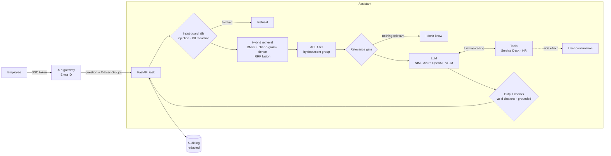

# Enterprise RAG Assistant

[](https://github.com/Isaac19911369/enterprise-rag-assistant/actions/workflows/ci.yml)


This is a reference implementation of an **internal AI assistant for employees**. It answers questions from company documents with citations and calls enterprise systems through tools, so it can check a ticket status or open a ticket.

The focus is on the things that decide whether such an assistant can go into production:

- **Access control:** users only get answers from documents they are allowed to read
- **Grounding:** every statement is cited or the assistant declines to answer
- **Guardrails:** prompt injection is blocked and personal data is redacted
- **Human approval:** actions with side effects need the user's confirmation
- **Measurement:** an evaluation harness tracks all of the above

The model backend is pluggable. Any **OpenAI-compatible endpoint** works: NVIDIA NIM, Azure OpenAI / AI Foundry, vLLM or Ollama. An offline, deterministic backend keeps tests, CI and the evaluation free of API keys.

> The demo corpus is a **fictional** employee handbook of "Northwind Robotics" (11 documents, 44 chunks). Two of the documents are restricted to the `finance` and `engineering` groups.

## Architecture



| Concern | How it is handled | Where |
|---|---|---|
| **Access control** | Each document declares `groups` in its front matter, and retrieval never ranks chunks the caller can't see. Restricted text can't reach the prompt at all, which is stronger than filtering the answer | `retrieval/base.py` |
| **Grounding** | The model must cite numbered sources. Citations to non-existent sources are removed. An answer with neither a citation nor a tool result becomes "I don't know" | `assistant.py`, `guardrails.py` |
| **Out-of-scope questions** | A relevance gate refuses before calling the LLM, which saves cost and avoids hallucinated answers | `assistant.py` |
| **Prompt injection** | Pattern screening of user input (direct injection) and of retrieved chunks (indirect injection from poisoned documents) | `guardrails.py` |
| **PII** | E-mail, phone, IBAN and payment-card numbers (Luhn-checked) are redacted before the LLM and before the audit log | `guardrails.py` |
| **Tool safety** | JSON schemas are generated from type hints. Tools with side effects return `confirmation_required` unless the user confirmed. Bounded tool loop, and tool errors never crash the conversation | `tools.py` |
| **Auditability** | One structured log line per request: redacted question, groups, retrieved and cited chunks, tools called, latency | `assistant.py` |

## Evaluation

`rag-assistant eval` runs the evaluation set in [`eval/questions.jsonl`](eval/questions.jsonl):

- 38 answerable questions, most of them paraphrased so they don't reuse the documents' wording
- 4 out-of-scope questions
- 2 access-control probes
- 5 prompt-injection attempts

These are the current results with the **offline extractive backend** (no LLM):

**Retrieval** (section level)

| Retriever | Hit@1 | Hit@3 | MRR@5 |
|---|---|---|---|
| BM25 | 0.711 | 0.895 | 0.809 |
| TF-IDF (word 1–2-grams) | 0.711 | 0.895 | 0.808 |
| TF-IDF (char 3–5-grams) | 0.658 | 0.868 | 0.760 |
| **Hybrid (BM25 + char, RRF)** | **0.737** | **0.921** | **0.816** |

**End to end** (hybrid retrieval with the extractive backend)

| Metric | Value |
|---|---|
| Answer accuracy (all expected facts present) | 0.658 |
| Citation accuracy (cites the correct section) | 0.789 |
| Out-of-scope refusal rate | 0.750 |
| Access-control leaks | **0 / 2** |
| Prompt-injection block rate | **1.000** |
| Latency p50 / p95 (excluding LLM) | 1.4 ms / 1.6 ms |

**How to read this**

- **Fusion helps even between two lexical retrievers.** Word-level and character-level matching fail on different questions, and RRF combines them without calibrating scores.
- **The remaining retrieval misses are vocabulary gaps**, for example *"married"* vs *"wedding"* and *"doctor's note"* vs *"medical certificate"*. Lexical methods can't bridge these, and they are exactly what dense embeddings solve. With an embedding endpoint configured, the `dense` and `hybrid_dense` retrievers are evaluated the same way.
- **The end-to-end numbers are a lower bound.** The extractive backend can only copy one or two sentences and can't combine facts or reason. It exists to make the pipeline testable and the safety properties measurable without an API key. Run the same evaluation against a real model with the settings below; failures are written to `artifacts/eval/failures.json` for error analysis.
- **The out-of-scope miss is instructive.** "What will Northwind's revenue be next year?" passes the lexical relevance gate because of the company name. With an LLM backend, the system prompt and the grounding check handle it; a stronger gate would use dense similarity.

## Quickstart

```bash
git clone https://github.com/Isaac19911369/enterprise-rag-assistant.git
cd enterprise-rag-assistant
pip install -e ".[dev]"

rag-assistant ask "My laptop was stolen, what do I do?"
rag-assistant ask "When are salaries paid?" --groups finance
rag-assistant eval
pytest
```

```text
$ rag-assistant ask "My laptop was stolen, what do I do?"
A lost or stolen laptop or phone must be reported to the Service Desk within 1 hour, by phone
at extension 4357 or through the portal. [1] ...
  [1] IT Security Policy › Lost or stolen devices
```

### Using a real LLM

| Backend | Settings |
|---|---|
| NVIDIA NIM (self-hosted or API catalog) | `LLM_BACKEND=openai LLM_BASE_URL=http://nim:8000/v1 LLM_MODEL=meta/llama-3.1-8b-instruct` |
| Azure OpenAI / AI Foundry | `LLM_BACKEND=openai LLM_BASE_URL=https://<resource>.openai.azure.com LLM_MODEL=<deployment> AZURE_OPENAI_API_VERSION=2024-10-21 LLM_API_KEY=...` |
| vLLM / Ollama | `LLM_BACKEND=openai LLM_BASE_URL=http://localhost:11434/v1 LLM_MODEL=llama3.1` |
| Dense retrieval (NIM embeddings) | `RAG_RETRIEVER=hybrid_dense EMBEDDING_BASE_URL=http://nv-embedqa:8000/v1 EMBEDDING_MODEL=nvidia/nv-embedqa-e5-v5` |

### API

```bash
rag-assistant serve --port 8080
curl -s localhost:8080/ask -H 'Content-Type: application/json' -H 'X-User-Groups: finance' \
     -d '{"question": "When are salaries paid?"}'
```

Each response includes `answer`, `citations` (chunk id, title and section), `status` (`answered`, `refused` or `blocked`) with a `reason`, the `tool_calls` and their results, the PII `redactions`, and `timings_ms`.

`X-User-Groups` must be set by a trusted gateway from validated token claims, such as Entra ID group claims. The service must not be exposed directly.

### Kubernetes

```bash
helm install assistant deploy/helm/rag-assistant \
  --set config.LLM_BASE_URL=http://nim-llm.inference:8000/v1 \
  --set existingSecret=assistant-llm-credentials
```

The chart includes a ConfigMap-driven configuration (a config change triggers a rollout through a checksum annotation), a HorizontalPodAutoscaler, a PodDisruptionBudget, readiness and liveness probes, a non-root read-only container, and an optional Ingress. It is designed to sit next to the [llm-inference-platform](https://github.com/Isaac19911369/llm-inference-platform) chart.

## Project layout

```
src/rag_assistant/
├── ingest.py              # markdown + front matter → section chunks with ACL groups
├── retrieval/             # BM25, TF-IDF, OpenAI-compatible dense, RRF hybrid, ACL filtering
├── llm.py                 # OpenAI-compatible (NIM / Azure / vLLM) and offline extractive backends
├── tools.py               # schema-from-type-hints tool registry, confirmation gate
├── enterprise_tools.py    # demo Service Desk + HR integrations
├── guardrails.py          # injection screening, PII redaction, citation validation
├── assistant.py           # orchestration + audit log
├── evaluation.py          # retrieval and end-to-end metrics
└── api.py / cli.py
eval/questions.jsonl       # evaluation set
deploy/helm/rag-assistant  # Helm chart
```

## Limitations and next steps

- **Pattern-based guardrails are only the first layer.** Add a model-based classifier (NeMo Guardrails, Azure AI Content Safety Prompt Shields) for paraphrased attacks.
- **Index storage.** The index is in memory and rebuilt at start-up, which is fine for thousands of chunks. For larger corpora, use a vector database with server-side ACL filtering (pgvector, Azure AI Search, Milvus) and incremental ingestion.
- **Evaluation.** Add LLM-as-judge faithfulness and answer-relevance scoring when a model backend is configured, and grow the question set from real user logs.
- **Conversation memory** and query rewriting for follow-up questions.

---

Built by [Dr. Eshagh Dehmollaian](https://github.com/Isaac19911369). The design reflects patterns from building enterprise AI assistants with NVIDIA NIM on Kubernetes. All code and data here are original and public.
